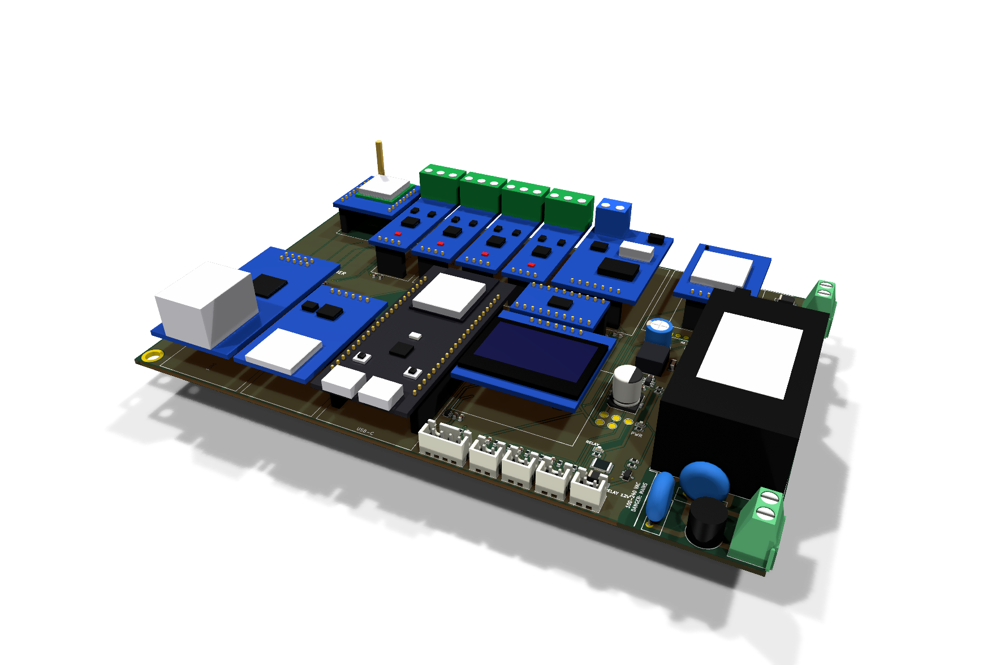
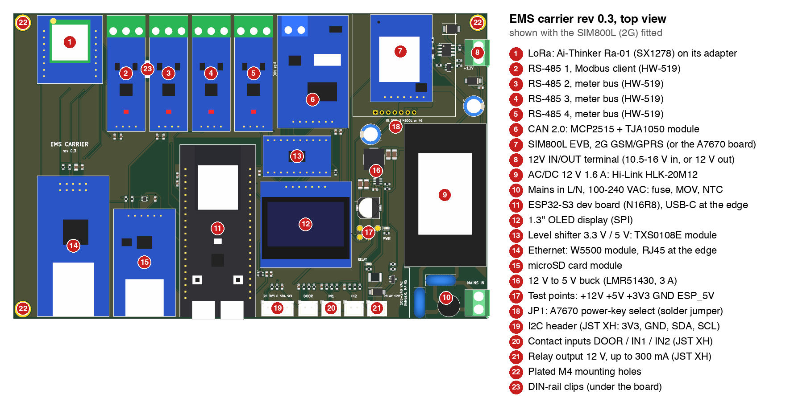
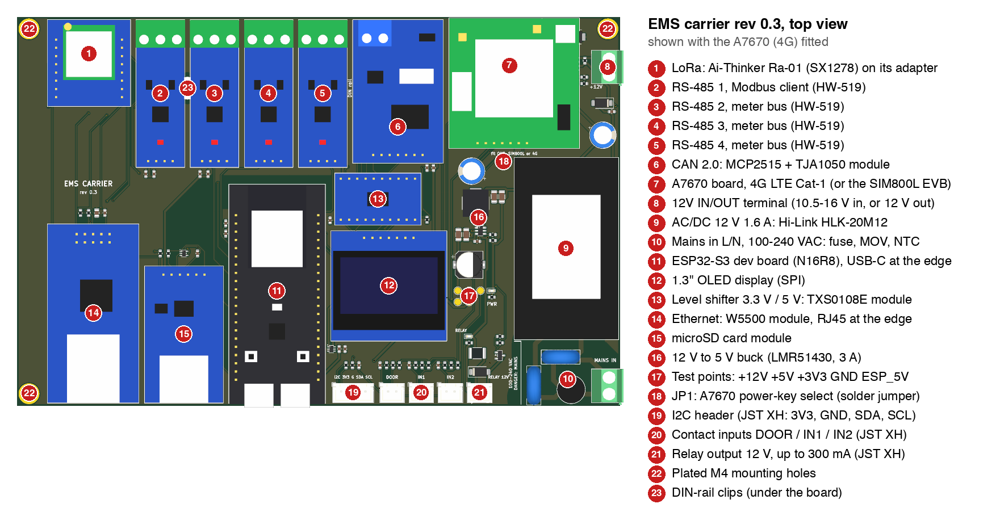
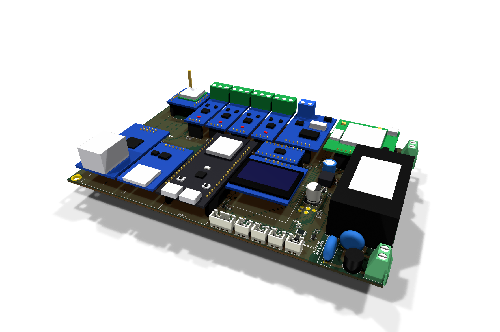
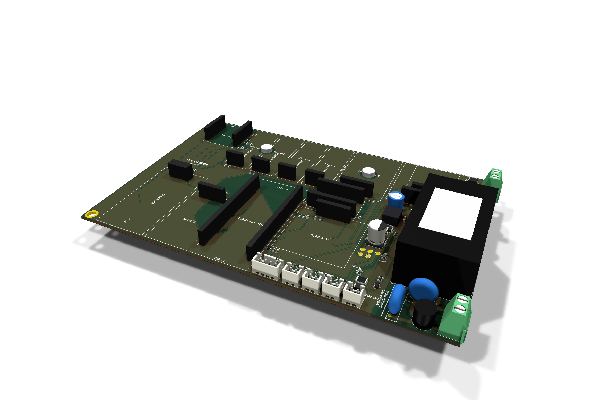
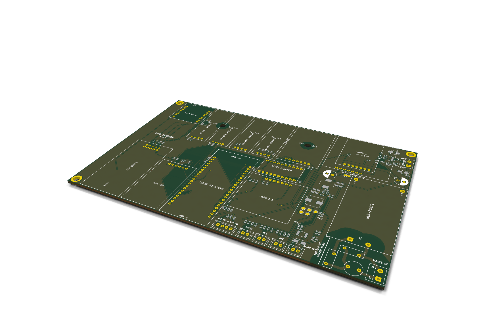

# EMS carrier (rev 0.3)

A PCB that carries the meshEMS dev-kit modules in sockets, replacing the hand-wired protoboard. The modules are the
same off-the-shelf parts the current build uses, plus Ethernet, microSD, LoRa and a cellular modem (2G or 4G). Every module plugs in and
can be swapped. Power comes from mains through an on-board 12 V supply or from an external 12 V source.

**Status: design complete, not yet fabricated or tested.** ERC and DRC are clean and the power and interface
circuits are simulated (see [Checks](#checks)). The first boards are meant for the pilot run and review.

## Board overview

Top views with every block numbered: the cellular position takes either modem.

## Features

| Block | Part | Notes |
|---|---|---|
| Controller | ESP32-S3 dev board (N16R8, 2 x 21 pins, rows 25.4 mm) | socketed; USB-C at the board edge for flashing and power |
| RS-485 x 4 | HW-519 modules | Modbus client port + three meter buses (DLMS, DL/T 645, Modbus) |
| CAN 2.0 | MCP2515 + TJA1050 module (HW-184) | via the TXS0108E level shifter |
| Ethernet | W5500 module (2 x 5) | 3.3 V SPI |
| Storage | microSD module (1 x 6) | its MISO is gated by a 74LVC1G125 so it can share the SPI bus |
| LoRa | Ra-01-footprint socket (SX127x, SPI) | fitted with a Ra-01 |
| Cellular | SIM800L EVB V2.0 5V (2G GSM/GPRS) **or** an A7670 4G board (SIMCom A7670E, LTE Cat-1 with GSM fallback, 40 x 40 mm) | two 7-pin sockets in one 40 x 40 mm position, each in its board's pin order; fit one. 2 x 1000 uF for the transmit bursts |
| Display | 1.3" SH1106 OLED, SPI | |
| Inputs | DOOR, IN1, IN2 on JST XH 2-pin | dry contacts (reed, limit switch, button), read on one ADC pin |
| I2C | JST XH 4-pin (+3V3, GND, SDA, SCL) | 4.7k pull-ups |
| Relay output | JST XH 2-pin, 12 V, up to 300 mA | low-side MOSFET for an external relay or contactor coil |
| Power | HLK-20M12 (100-240 VAC -> 12 V 1.6 A) or the 12V IN/OUT terminal (10.5-16 V) | LMR51430 buck 12 V -> 5 V, 3 A; reverse-polarity and surge protected |
| Mounting | 3 x plated M4 corner holes (4.3 mm, 6.4 mm ring; 178.6 x 112.6 mm pattern) + 2 Bud DNC-4796 DIN-rail clips | M4 screws with a 7 mm head (ISO 4762 / ISO 14580); the fourth corner holds the mains input |

Board: 186 x 120 mm, 2 layers, 1.6 mm. Mains copper is kept 6.5 mm from all SELV copper and from the
screw and DIN-clip metal.

On USB power alone, everything except the modem (SIM800L or A7670) and the 12 V relay output runs: the ESP32 board feeds the 5 V
module rail. The 5 V modules then get about 4.2-4.5 V, below the 4.75 V minimum in the RS-485 and CAN transceiver
datasheets, so USB-only operation is meant for the bench. The modem runs from the 12 V supply only, because its
2 A transmit bursts would brown out a USB port.

| With the A7670 (4G) instead | As assembled, before the modules go in | Plain PCB |
|---|---|---|
|  |  |  |

## Files

| Path (in `hardware/ems-carrier/`) | Contents |
|---|---|
| `kicad/` | KiCad project: schematic, PCB, design rules, title block sheet. **Requires KiCad 10.** The 3D models of the plug-in modules are not included; use the renders in `docs/` for 3D views. |
| `lib/` | project symbol and footprint libraries (`ems.kicad_sym`, `ems.pretty/`) for the modules, the HLK-20M12, the DIN clips and the M4 holes |
| `fab/` | JLCPCB production files: Gerbers + drills (`ems-carrier-gerbers.zip`), BOM (`bom-jlc.csv`), placement (`cpl-jlc.csv`), parts fitted by hand (`hand-fit.csv`), 3D model of the board (`ems-carrier.step`) |
| `docs/` | this README; schematic PDF ([`ems-carrier-schematic.pdf`](ems-carrier-schematic.pdf)); `images/`: annotated top views; 3D renders, angled (`*-iso*.png`) and top (`ems-carrier-3d.png` with the SIM800L, `-3d-4g.png` with the A7670, `-3d-assembled.png` before the modules, `-3d-bare.png` plain PCB); routed copper (`ems-carrier-routed.png`, `.svg`) |

## Checks

- ERC: 0 errors, 0 warnings.
- DRC with schematic parity: 0 errors, 0 unconnected. There are 22 silkscreen warnings: module outlines over small
  pads under the modules, terminal outlines at the board edge and a label over a DIN-clip hole; the fab trims silk
  off pads and holes.
- Independent mains clearance check (6.5 mm from mains to every other net): 0 violations.
- Simulations (ngspice):
  - contact inputs: all 8 combinations readable;
  - 12 V supply and buck, worst case including SIM800L bursts: 5 V module rail 4.77-5.05 V, SIM800L supply at
    least 4.71 V, LM66100 peak current 0.94 A (1.5 A rating);
  - RS-485 receive divider: pass;
  - relay driver: pass.

## Before the first build

- Print the board 1:1 and check each module's header order and outline against the modules you have. This covers
  the W5500, microSD, Ra-01 adapter, SIM800L and A7670 boards, whose pinouts vary between suppliers.
- A7670 board: the socket follows its pin labels (GND URX UTX PWR-K 5-12V GND SLEEP) and a 40 x 40 mm outline.
  PWR-K is set by solder jumper JP1: 1-2 (default) = pulsed low by firmware through the modem reset line;
  2-3 = held at GND, so the modem starts at power-up; all open = left to the board.
- Measure the +5V dip during SIM800L transmit bursts on the first board. The buck model in the simulation is
  averaged.

## Licence

CERN-OHL-W-2.0, as the rest of this repository.

Designed by Christopher Bartonjo  
MetroTel, [www.metrotelinc.io](https://www.metrotelinc.io)
